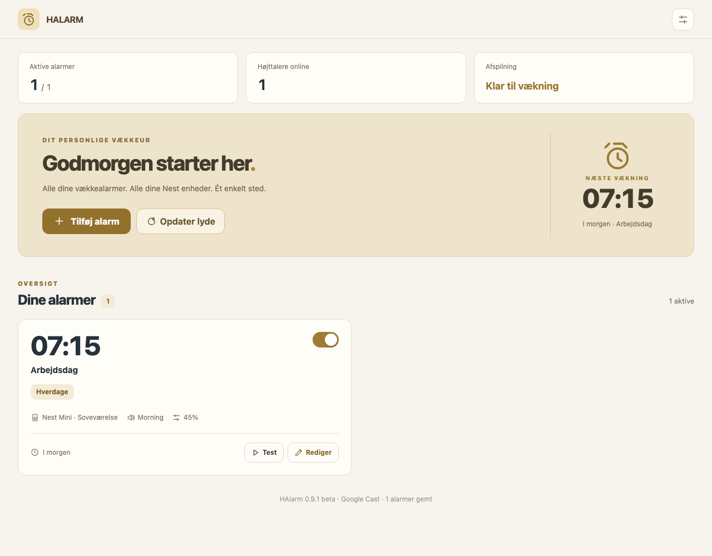

# HAlarm · Home Assistant alarm manager

**HAlarm** er en lokal, selvstændig Home Assistant alarmcentral til Google Cast højttalere (Nest Hub, Nest Audio og Nest Mini) med et roligt, varmt gult interface, inspireret af det enkle ESPHealth-dashboard.

> **Status: 0.9.1 beta.** Google Cast eksponerer ikke en dedikeret begivenhed for »Hey Google, stop«. HAlarm udleder et stop fra ændringer i `media_player` tilstanden. Stoplogikken er regressionstestet mod Home Assistant 2026.11.1; fysisk stemmestop på Nest-enheder skal fortsat afprøves i din installation.

## Funktioner

- Ubegrænset antal alarmprofiler med navn, tidspunkt og individuel aktivering
- Hver dag / hverdage / weekend eller valgfri kombination af ugedage
- Forskellig Google Cast højttaler, lyd og lydstyrke for hver alarm
- Automatisk MP3 registrering i `halarm/sounds/`
- Lydprøve, stopknap, »stop alle«, test og separat status på aktive alarmer
- Gentagelse ved naturlig `idle`-afslutning; `off` og `paused` stopper altid, også tæt på lydens slutning
- Kompakt statusoversigt, mobilvisning, mørk visning og dæmpet gul accent
- Vedvarende lydmappe uden for integrationsmappen, så HACS-opdateringer bevarer MP3-filer
- Log over de seneste tilstandsskift for at hjælpe med fejlsøgning på Nest Mini
- Forsøger automatisk at importere alarmer fra Alarmcentral 2.x (`.storage/alarmpanel.v2`)

## Installation / migrering fra Alarmcentral

1. **Tag backup først** af den gamle `custom_components/alarmpanel/` mappe, filen `packages/alarmpanel.yaml` og `.storage/alarmpanel.v2`. Redigér ikke filer under `.storage` manuelt.
2. **Kopiér MP3 filer** fra `custom_components/alarmpanel/sounds/` til `/config/halarm/sounds/`. Ved opgradering fra HAlarm 0.9.0 kopieres filer fra `custom_components/halarm/sounds/` automatisk, uden at eksisterende filer overskrives. Når kopieringen er kontrolleret, kan gamle kopier fjernes fra integrationsmappen.
3. **Kopiér `custom_components/halarm/`** fra denne pakke til `/config/custom_components/halarm/`.
4. **Tilføj** `/config/packages/halarm.yaml` med indholdet `halarm: {}`. Din eksisterende `configuration.yaml` med `homeassistant: packages: !include_dir_named packages` forbliver uændret.
5. **Fjern eller omdøb** den gamle `/config/packages/alarmpanel.yaml`, så to alarm-motorer ikke aktiveres samtidigt. Lad den gamle integration være backup frem til første succesfulde opstart, men den må ikke være aktiv via package-filen.
6. Kontrollér Home Assistants konfiguration, og genstart. Åbn **HAlarm** i venstremenuen. En eksisterende Alarmcentral alarm importeres automatisk første gang (hvis `.storage/alarmpanel.v2` findes).
7. Hvis panelet viser gammel kode: genindlæs siden uden cache (Cmd+Shift+R eller Ctrl+Shift+R).

**Ny installation**: spring migration/backup af gammel version over, kopiér `custom_components/halarm/`, opret `packages/halarm.yaml`, kontrollér og genstart.

### Struktur

```text
/config/
  packages/halarm.yaml                 # halarm: {}
  halarm/sounds/Morning.mp3            # dine egne MP3-filer, bevares af HACS
  custom_components/halarm/            # integrationskode administreret af HACS
  .storage/halarm.v1                   # alarmer og indstillinger, administreret af HA
```

Alle MP3-filer i `/config/halarm/sounds/` vises automatisk. `Alarm_` er ikke påkrævet; gamle filer med dette præfiks vises fortsat uden det i vælgeren. Eksisterende alarm-id'er, navne, tidspunkter, dage, højttalere, lydvalg, lydstyrke, aktivering og intern URL bevares. Lagerformatet og nøglen `halarm.v1` er uændret.

## Google Cast og stemmestop

1. Vælg alarm og Google enhed, tryk **Test**, og sig »Hey Google, stop« efter at lydfilen er begyndt at spille.
2. Hvis højttaleren fortsætter alarmen eller den gentages, åbn **HAlarm → Indstillinger → Seneste stop og afspilningstilstande**.
3. Notér den konkrete overgang, fx `playing → idle` eller `playing → off`, og vis også tilsvarende `media_player` tilstand i **Udviklerværktøjer → Tilstande**.

Efter bekræftet afspilning stopper `paused` og `off` hele alarmkørslen. Et tidligt `idle` stopper også. Kun `idle` tæt på en kendt lydlængde gentager filen; opstartstiden for Cast tæller ikke med i lydlængden. Et efterfølgende `idle → off` annullerer den ventende gentagelse. Alarmprofilen forbliver aktiveret til næste planlagte vækning.

Cast giver ikke en sikker måde at skelne stemmestop fra manuel pause eller naturlig afslutning. Et stop i de sidste højst 1,5 sekunder kan ligne en naturlig `idle`-afslutning. Hvis en model melder `off` ved naturlig afslutning, stopper den efter første gennemspilning. Ukendt lydlængde medfører stop ved `idle`; ukendt/mistet forbindelse stopper med en fejl. **Brug helst en CBR MP3 på mindst 30 sekunder**, og kontrollér gentagelse og stemmestop på din konkrete højttaler.

Hvis den valgte enhed ikke begynder at spille: angiv Home Assistants lokale adresse med LAN IP og port under HAlarm Indstillinger (fx `http://192.168.1.20:8123`). Højttaleren skal kunne nå filen over netværket. Der prøves både Home Assistants mediebibliotek og direkte `/local/halarm/` URL.

### Lydfiler og sikkerhed

Originale lyde vedligeholdes i `/config/halarm/sounds/`. HAlarm spejler dem til `/config/www/halarm/` samt Home Assistants mediebibliotek for at gøre dem tilgængelige for Cast. **Filerne under `/local/halarm/` er offentligt tilgængelige for klienter, der kender adressen.** Brug derfor kun ikke-følsomme lydfiler. Der følger ingen ophavsretligt beskyttede alarmlyde med kildekoden.

## Installation via HACS

**Før første HACS-opgradering fra 0.9.0:** kopiér dine MP3-filer til `/config/halarm/sounds/`, før HACS erstatter integrationsmappen. Automatisk import kan kun læse filer, der stadig findes ved opstart.

HACS → menuen med tre prikker → **Custom repositories** → repository URL `https://github.com/JRJenZens/HAlarm` → type **Integration** → download → genstart → tilføj `halarm: {}` i en eksisterende package eller `configuration.yaml`.

Udgivelsen er markeret beta; slå visning af betaudgaver til i HACS, hvis du vil vælge release-versionen. Kræver Home Assistant **2026.11 eller nyere**. HAlarm installeres som et brugerdefineret repository; det er ikke optaget i HACS' standardkatalog. Indstillinger under `.storage` og MP3-filer under `/config/halarm/` ligger uden for mappen, HACS udskifter.

[Åbn repository i HACS](https://my.home-assistant.io/redirect/hacs_repository/?owner=JRJenZens&repository=HAlarm&category=integration)



## Fejlsøgning

- **Intet HAlarm menupunkt:** kontrollér `/config/packages/halarm.yaml` og `custom_components/halarm/manifest.json`, og genstart.
- **Gamle alarmer ikke importeret:** kontrollér, at `.storage/alarmpanel.v2` stadig er til stede. Den gamle fil ændres ikke under migration.
- **Alarmen ringer ikke:** kontrollér at MP3-filen vises under lydvælger, og at Cast-enheden kan nå HA's interne URL.
- **Stemmestop virker kun på Hub:** kontrollér panelets diagnostik. Forskel mellem modellerne er netop årsagen til, at der nu også lyttes efter `idle` og `paused`.
- **Dobbelt vækning:** kontrollér at `packages/alarmpanel.yaml` er deaktiveret.

## Udvikling

Python 3.14 og Home Assistant 2026.11.1 bruges til integrationstests. JavaScript kræver ingen buildværktøjer.

```sh
python -m venv .venv
.venv/bin/pip install -r requirements-test.txt
.venv/bin/python -m unittest discover -s tests -v
PYTHONPATH=. .venv/bin/python tests/runtime_check.py
.venv/bin/python -m playwright install chromium
.venv/bin/python tests/browser_check.py
```

Se [testresultater og fysisk testplan](docs/validation.md). Browsertesten bruger simulerede data og aktiverer ingen højttalere.

## Licens

MIT. Projektet er ikke affilieret med Google eller Home Assistant. 
